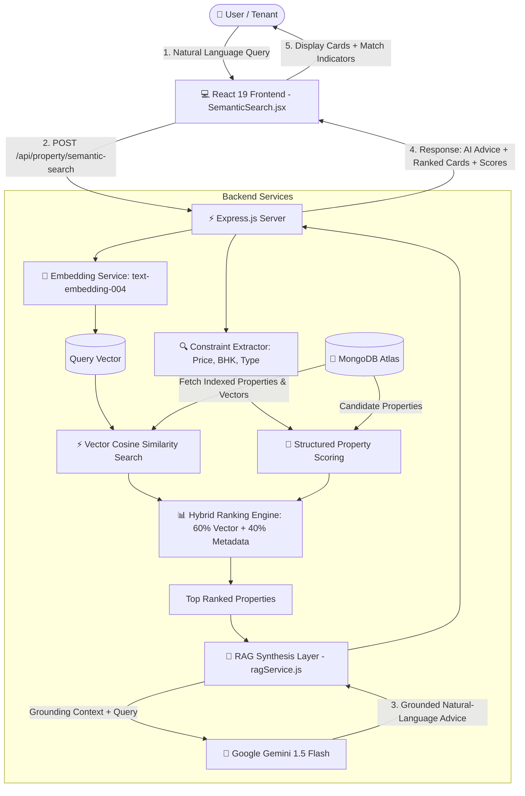

# 🏡 Rentify - Full-Stack Property Rental Marketplace with RAG Semantic Search

[](https://nodejs.org/)
[](https://react.dev/)
[](https://tailwindcss.com/)
[](https://www.mongodb.com/atlas)
[](https://aistudio.google.com/)
[](https://opensource.org/licenses/ISC)

**Rentify** is a modern, production-ready property rental application connecting property owners with prospective tenants. Tenants can explore rental properties with interactive map integration, structured multi-parameter filters, personalized wishlists, and a **Retrieval-Augmented Generation (RAG) semantic search engine** that understands natural language queries.

---

## 🌟 What's New: RAG-Powered Semantic Property Search

Traditional rental search engines rely on exact keyword matches and manual range sliders. Rentify introduces **RAG Semantic Search**, allowing tenants to describe what they want in everyday language:

> *"Find a 2BHK apartment near Chandigarh University under ₹20,000"*  
> *"I need a furnished house with parking for a family"*  
> *"Affordable properties near the university with good connectivity"*  
> *"Show me houses with 2 bedrooms and a balcony"*  
> *"Find a pet-friendly rental with parking"*

### 🧠 How It Works:
1. **Query Understanding & Constraint Extraction**: The engine extracts structured requirements (e.g., maximum budget $\le$ ₹20,000, 2 BHK, furnished status, amenities, and location hints).
2. **Dense Vector Embeddings**: Property listings are converted into dense vector representations using text embedding models (`text-embedding-004` or built-in deterministic local semantic vectorizer).
3. **Hybrid Search & Ranking**: Combines vector cosine similarity with structured metadata scoring, ensuring results match both semantic intent and physical constraints without hallucination.
4. **RAG Context Synthesis**: The top retrieved matching listings are packaged into a grounded context window and sent to the LLM (`gemini-1.5-flash`), generating a personalized, factual recommendation that references only verified properties.

---

## 🏗️ Architecture & Data Flow



---

## 💸 100% Free-Tier Deployment Architecture

Rentify is specifically architected to run permanently within generous free-tier cloud quotas:

| Component | Free-Tier Service | Purpose | Free Allocation |
| :--- | :--- | :--- | :--- |
| **Frontend** | [Vercel](https://vercel.com/) / [Netlify](https://www.netlify.com/) | Static SPA Hosting | 100 GB bandwidth / mo |
| **Backend API** | [Render](https://render.com/) / [Vercel](https://vercel.com/) | Node.js Express server | 750 free compute hours / mo |
| **Database** | [MongoDB Atlas](https://www.mongodb.com/atlas) | M0 Sandbox Cluster | 512 MB storage, shared RAM |
| **Image Hosting** | [Cloudinary](https://cloudinary.com/) | Property photo uploads | 25 GB credits / mo |
| **AI Embeddings & LLM**| [Google AI Studio](https://aistudio.google.com/) | Gemini 1.5 Flash & Embeddings | 15 RPM, 1M TPM, 1,500 RPD free |
| **Map Tiles** | [Leaflet](https://leafletjs.com/) + OpenStreetMap | Interactive location map | Unlimited public OSM tiles |

> [!NOTE]
> **No Paid Infrastructure Required**: No paid vector databases (Pinecone, Weaviate), no paid Redis caches, and no AWS instances are required. If no AI API key is configured, the application automatically uses its built-in zero-cost deterministic semantic vectorizer and template synthesizer with zero crashes.

---

## 🔌 API Endpoints Reference

### 1. Semantic Property Search (RAG)
- **Endpoint**: `POST /api/property/semantic-search` (also available via `GET` and alias `/api/properties/semantic-search`)
- **Headers**: `Content-Type: application/json`
- **Request Body**:
  ```json
  {
    "query": "2BHK furnished apartment near university with parking under 20000",
    "limit": 9
  }
  ```
- **Example Response**:
  ```json
  {
    "query": "2BHK furnished apartment near university with parking under 20000",
    "extractedConstraints": {
      "maxPrice": 20000,
      "bhk": 2,
      "furnished": "Furnished",
      "type": "Apartment",
      "amenities": ["parking"]
    },
    "aiResponse": "Based on your requirements, I found 3 properties that closely match your search. The top recommendation is **2 BHK Furnished Apartment near Chandigarh University** located in Chandigarh University Area, Chandigarh offered at ₹18,000/month with 2 BHK (Furnished) accommodation. It includes parking and balcony.",
    "results": [
      {
        "property": {
          "_id": "673f1a2b...",
          "title": "2 BHK Furnished Apartment near Chandigarh University",
          "price": 18000,
          "bhk": 2,
          "furnished": "Furnished",
          "type": "Apartment",
          "location": "Chandigarh University Area, Chandigarh",
          "amenities": ["Parking", "Balcony", "WiFi", "24/7 Security"],
          "images": ["https://images.unsplash.com/..."],
          "ownerId": {
            "name": "Sarah Jenkins",
            "phone": "555-0101"
          }
        },
        "score": 0.7469,
        "vectorScore": 0.503,
        "matchReasons": [
          "High semantic alignment with your query",
          "Matches exact 2 BHK requirement",
          "Within budget: ₹18,000 (under ₹20,000)",
          "Furnished accommodation",
          "Property type: Apartment",
          "Includes parking"
        ]
      }
    ],
    "count": 1
  }
  ```
> *Internal float embeddings are excluded from the API response to minimize network payloads and protect private vector representations.*

### 2. Core API Endpoints
- `GET /api/property` - Fetch all properties with optional query parameters (`location`, `bhk`, `furnished`, `minPrice`, `maxPrice`)
- `GET /api/property/:id` - Fetch single property details
- `POST /api/property` - Create a new property with automated embedding generation *(Owner auth required)*
- `PUT /api/property/:id` - Update existing property and refresh embedding *(Owner auth required)*
- `DELETE /api/property/:id` - Delete property listing *(Owner auth required)*
- `POST /api/auth/register` - Register a new User or Owner account
- `POST /api/auth/login` - User login and JWT generation
- `GET /api/health` - Service health-check monitor

---

## 🛠️ Project Structure

```text
Rentify/
├── client/                         # React 19 Frontend (Vite 8 + Tailwind CSS v4)
│   ├── src/
│   │   ├── components/
│   │   │   ├── SemanticSearch.jsx  # AI search bar, chips & RAG recommendation card
│   │   │   ├── PropertyCard.jsx    # Card with match indicators & reasons
│   │   │   ├── FilterSidebar.jsx   # Traditional filter controls
│   │   │   ├── Navbar.jsx          # Top navigation bar
│   │   │   └── MapComponent.jsx    # Leaflet map component
│   │   ├── pages/
│   │   │   ├── Home.jsx            # Unified discovery view (Semantic + Filters)
│   │   │   ├── PropertyDetails.jsx # Detailed specs, amenities & owner contact
│   │   │   ├── AddProperty.jsx     # Owner listing creator with amenities
│   │   │   ├── EditProperty.jsx    # Owner listing editor
│   │   │   ├── OwnerDashboard.jsx  # Listings manager for owners
│   │   │   └── Login.jsx / Signup.jsx
│   │   ├── services/
│   │   │   └── api.js              # Axios instance with JWT interceptor
│   │   └── App.jsx
│   ├── .env.example
│   └── package.json
├── server/                         # Node.js + Express Backend
│   ├── config/
│   │   ├── db.js                   # Mongoose connection with resilient local fallback
│   │   └── cloudinary.js           # Cloudinary configuration
│   ├── controllers/
│   │   ├── propertyController.js   # Handlers for CRUD & semanticSearch
│   │   ├── authController.js       # Authentication & JWT issuance
│   │   └── wishlistController.js   # Wishlist management
│   ├── middleware/
│   │   ├── auth.js / role.js       # JWT & Role validation
│   │   └── upload.js               # Multer memory storage
│   ├── models/
│   │   ├── Property.js             # Schema with amenities & vector embedding
│   │   └── User.js                 # Tenant & Owner account schema
│   ├── routes/
│   │   ├── propertyRoutes.js       # Mounted routes including /semantic-search
│   │   ├── authRoutes.js
│   │   └── wishlistRoutes.js
│   ├── scripts/
│   │   └── generateEmbeddings.js   # CLI utility to index properties into vectors
│   ├── services/
│   │   ├── embeddingService.js     # Gemini / OpenAI / Deterministic vectorizer
│   │   ├── ragService.js           # LLM RAG prompt synthesis engine
│   │   └── semanticSearchService.js# Hybrid scoring & constraint extractor
│   ├── seed.js                     # Sample owners and properties generator
│   ├── server.js                   # Express application entrypoint
│   ├── .env.example
│   └── package.json
├── .gitignore
├── .env.example
└── README.md
```

---

## ⚡ Quickstart & Local Setup

### 📋 Prerequisites
- [Node.js](https://nodejs.org/) (v18 or higher recommended)
- [MongoDB](https://www.mongodb.com/) (Local installation or free MongoDB Atlas cluster)

### 1. Backend Setup
1. Navigate to the `server/` directory:
   ```bash
   cd server
   ```
2. Install dependencies:
   ```bash
   npm install
   ```
3. Copy the sample environment file:
   ```bash
   cp .env.example .env
   ```
4. Configure your `.env` file:
   ```env
   PORT=5000
   MONGO_URI=mongodb://localhost:27017/rentify
   JWT_SECRET=rentify_super_secret_jwt_key
   CLOUD_NAME=your_cloudinary_cloud_name
   CLOUD_API_KEY=your_cloudinary_api_key
   CLOUD_API_SECRET=your_cloudinary_api_secret
   GEMINI_API_KEY=your_free_gemini_api_key
   AI_MODEL=gemini-1.5-flash
   ```
   *(Note: If you do not have a Gemini API key yet, you can leave `GEMINI_API_KEY` blank; Rentify's local deterministic vectorizer will automatically handle embeddings without errors!)*

5. Prepopulate sample rental properties:
   ```bash
   npm run seed
   ```

6. Generate or update vector embeddings for all properties:
   ```bash
   npm run generate-embeddings
   ```
   *(To re-embed all items forcibly, run `node scripts/generateEmbeddings.js --force`)*

7. Start the backend development server:
   ```bash
   npm run dev
   ```
   Server runs at `http://localhost:5000`.

---

### 2. Frontend Setup
1. Open a new terminal and navigate to the `client/` directory:
   ```bash
   cd client
   ```
2. Install dependencies:
   ```bash
   npm install
   ```
3. Copy the sample environment file:
   ```bash
   cp .env.example .env
   ```
   Ensure `VITE_API_URL=http://localhost:5000/api`.

4. Start the frontend development server:
   ```bash
   npm run dev
   ```
5. Open your browser at `http://localhost:5173`.

---

## ☁️ Free Deployment Guide

### Deploying the Backend on Render (Free Web Service)
1. Push your repository to GitHub.
2. Sign in to [Render](https://render.com/) and click **New > Web Service**.
3. Connect your Rentify repository and configure:
   - **Root Directory**: `server`
   - **Build Command**: `npm install`
   - **Start Command**: `npm start`
4. In the **Environment Variables** tab, add:
   - `MONGO_URI`: Your MongoDB Atlas connection string
   - `JWT_SECRET`: A secure random string
   - `CLOUD_NAME`: Cloudinary cloud name
   - `CLOUD_API_KEY`: Cloudinary API key
   - `CLOUD_API_SECRET`: Cloudinary API secret
   - `GEMINI_API_KEY`: Your Google AI Studio API key
   - `AI_MODEL`: `gemini-1.5-flash`
5. Click **Deploy Web Service**. Render provides a public URL (e.g., `https://rentify-backend.onrender.com`).

---

### Deploying the Frontend on Vercel (Free Hosting)
1. Sign in to [Vercel](https://vercel.com/) and click **Add New > Project**.
2. Import the Rentify repository.
3. Configure the project:
   - **Framework Preset**: `Vite`
   - **Root Directory**: `client`
4. In **Environment Variables**, add:
   - `VITE_API_URL`: Your deployed backend URL + `/api` (e.g., `https://rentify-backend.onrender.com/api`).
5. Click **Deploy**. Vercel will build and host your frontend website.

---

## 🔑 Environment Variables Reference

| Variable | Scope | Description | Default / Example |
| :--- | :--- | :--- | :--- |
| `PORT` | Backend | Port number for Express | `5000` |
| `MONGO_URI` | Backend | MongoDB connection URI | `mongodb+srv://...` |
| `JWT_SECRET` | Backend | Secret key used to sign JWT auth tokens | `your_secret_key` |
| `CLOUD_NAME` | Backend | Cloudinary Cloud Name for uploads | `your_cloud_name` |
| `CLOUD_API_KEY` | Backend | Cloudinary API Key | `your_cloud_key` |
| `CLOUD_API_SECRET` | Backend | Cloudinary API Secret | `your_cloud_secret` |
| `GEMINI_API_KEY` | Backend | Google AI Studio Gemini API Key | `your_gemini_key` |
| `AI_MODEL` | Backend | Generative AI model name | `gemini-1.5-flash` |
| `VITE_API_URL` | Frontend | Backend API endpoint base URL | `http://localhost:5000/api` |

---

## 🧪 Verification & Testing Checklist

- [x] **Natural Language Semantic Search**: Tested query *"Find a 2BHK apartment near Chandigarh University under 20000"* accurately identifies 2BHK listings within budget in Chandigarh.
- [x] **Amenity & Constraint Understanding**: Queries including *"furnished house with parking"* boost properties offering furnished accommodation and garage parking.
- [x] **Zero-Cost Offline Fallback**: Operates normally with full ranking when no `GEMINI_API_KEY` is present.
- [x] **RAG Context Grounding**: LLM prompt strictly uses retrieved properties and never fabricates prices, locations, or amenities.
- [x] **Property Embedding Script**: `npm run generate-embeddings` caches existing vectors and offers `--force` flag.
- [x] **Owner Flow & Automatic Embedding**: Newly added or edited properties have vectors generated automatically on save.
- [x] **Existing Feature Parity**: Traditional filters, Leaflet map, user login, owner dashboards, and wishlists remain completely functional.
- [x] **Clean Production Build**: Frontend builds cleanly with zero errors via Vite (`npm run build`).

---

## 📜 License
This project is licensed under the ISC License.
